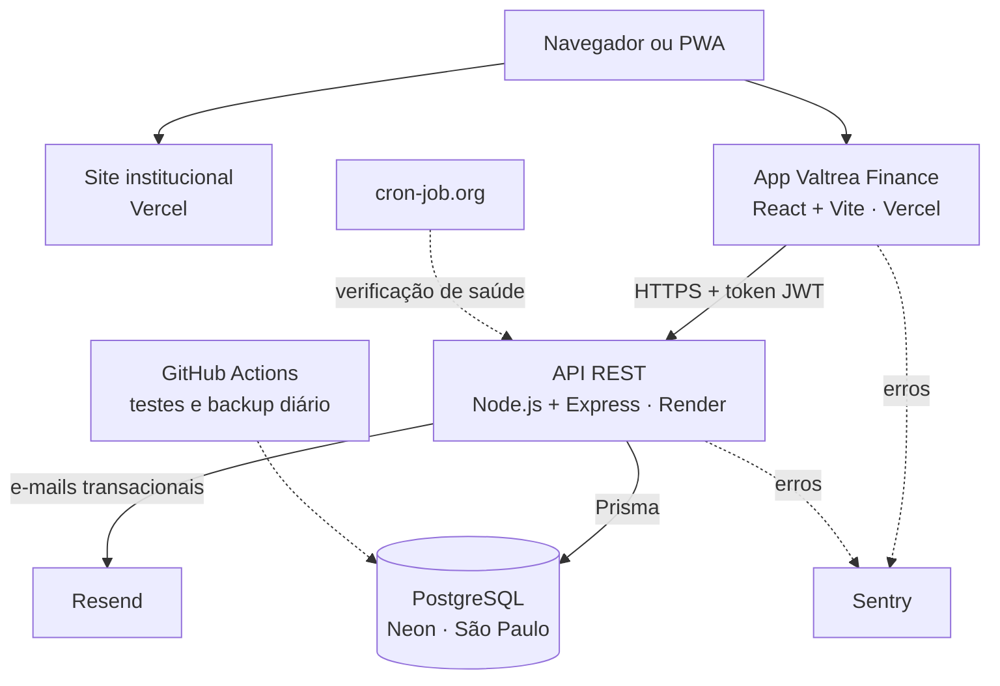

# Valtrea Finance

Aplicativo web de finanças pessoais: registre ganhos, gastos e investimentos, automatize as contas fixas e acompanhe o orçamento de cada categoria.

**[Acessar o app](https://finance.valtrea.com.br)** · **[Site da Valtrea](https://www.valtrea.com.br)**

> O código-fonte fica em um repositório privado. Este repositório apresenta o projeto, a arquitetura e as decisões técnicas. Para ver o código, entre em contato.

## Funcionalidades

| Área | O que faz |
| --- | --- |
| Saldo do período | Ganhos, gastos, investimentos e saldo de qualquer período, com gráfico de distribuição |
| Transações | Inclusão, edição e exclusão, com categoria, busca e filtro por tipo |
| Categorias | Distribuição dos gastos por categoria (moradia, alimentação, transporte e outras) |
| Recorrentes | Contas fixas lançadas automaticamente no dia escolhido, sem duplicar, com pausa e retomada |
| Orçamento | Limite mensal por categoria e quanto já foi gasto |
| Evolução mensal | Comparação mês a mês dos últimos 3 a 24 meses |
| Exportação | Download de todas as transações em CSV |
| Conta | Confirmação de e-mail, recuperação de senha e exclusão definitiva dos dados |
| PWA | Instalável na tela inicial do celular e do computador |
| Administração | Painel com indicadores agregados de uso e retenção, restrito a administradores |

## Arquitetura

Só a API acessa o banco de dados. O app e o site são estáticos e publicados na Vercel; a API roda no Render e é publicada automaticamente a cada push na branch principal, aplicando as migrações do banco.

## Tecnologias

| Camada | Tecnologias |
| --- | --- |
| Front-end | React 18, Vite, Tailwind CSS, TanStack Query, React Hook Form, Zod, Recharts |
| Back-end | Node.js 20, Express, Prisma, Zod, JWT, bcrypt, Swagger |
| Banco de dados | PostgreSQL (Neon) com migrações versionadas |
| Infraestrutura | Vercel, Render, Docker para desenvolvimento local, DNS e e-mail com domínio próprio |
| Qualidade | GitHub Actions, teste de ponta a ponta da API, Dependabot, Sentry |

## Segurança e privacidade

- Senhas com bcrypt; tokens de acesso de curta duração com renovação automática
- Cada usuário só acessa os próprios dados, verificado em todas as rotas
- Bloqueio temporário após tentativas seguidas de senha errada, com aviso por e-mail ao titular
- Links de e-mail com validade curta, uso único e armazenados apenas como hash
- Limite de requisições por IP e cabeçalhos de segurança na API, no app e no site
- Monitoramento de erros sem dados pessoais, senhas ou tokens
- Backup diário criptografado do banco
- Exclusão de conta apaga todos os dados do usuário; Termos de Uso e Política de Privacidade alinhados à LGPD

## Qualidade e operação

- **Integração contínua:** a cada push, o GitHub Actions sobe um PostgreSQL, aplica as migrações, inicia a API e roda um teste de ponta a ponta que cobre conta, transações, relatórios, orçamento, recorrentes, administração e segurança. Também faz o build do app e do site.
- **Documentação da API:** todas as rotas descritas com Swagger, com exemplos de envio e de resposta.
- **Deploy contínuo:** Vercel e Render publicam a cada push; as migrações do banco são aplicadas automaticamente.
- **Atualizações:** Dependabot verifica as bibliotecas toda semana.

## Autor

**João Adolfo** · Estudante de Engenharia de Software (UVA) e fundador da [Valtrea](https://www.valtrea.com.br)
Contato: contato@valtrea.com.br
